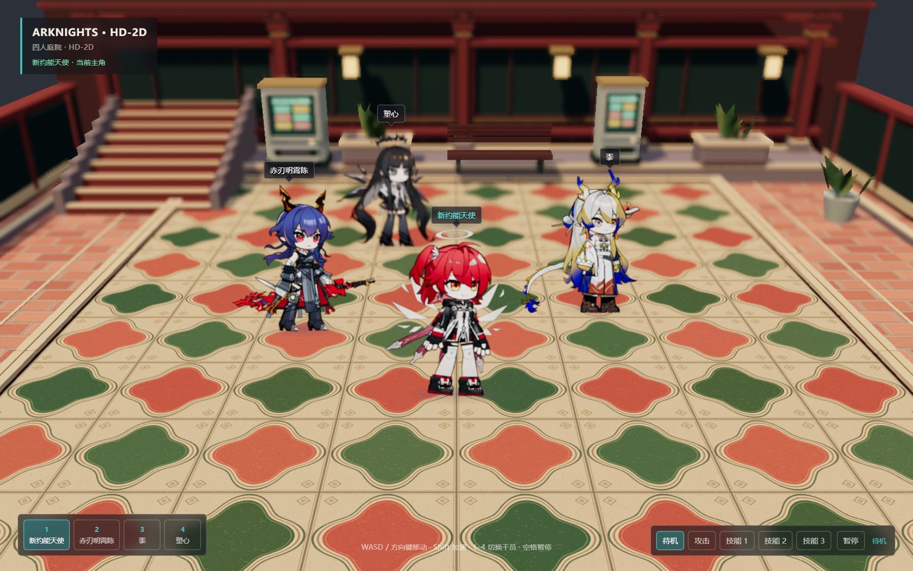
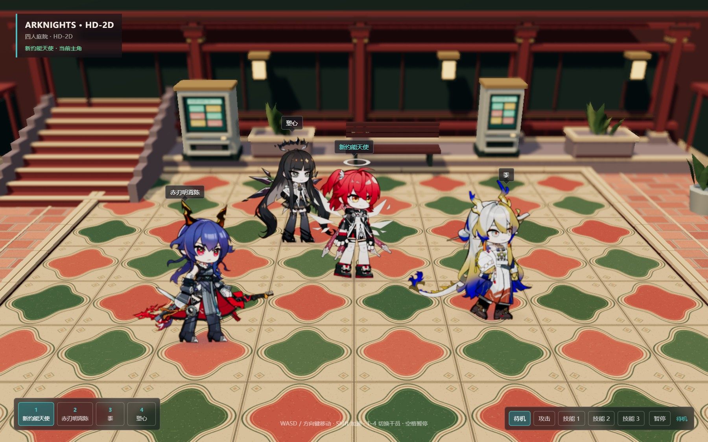

# Ark HD-2D Three.js 原型

这是一个纯 Three.js 的 HD-2D 场景：程序化地面、透视相机、AlphaTest 景深、接触阴影、四名干员和 Spine 3.8 模型转换出的透明分页帧图集。网页运行时只加载 Three.js 和本地帧图集，不依赖 Spine runtime 或远程 PRTS 请求。

## 在线体验

GitHub Pages 会在 `main` 分支更新后自动构建和部署：

**[打开在线场景](https://fwz233-re.github.io/ark-hd2d-threejs-prts/)**

> 首次打开需要等待角色帧图集加载完成。页面使用 Git LFS 存储大型 PNG 和 Spine 源文件。





## 启动

```bash
npm install
npm run dev
```

然后打开 Vite 输出的本地地址。资源不能通过 `file://` 直接打开，必须经过本地开发服务器。

操作方式：

- 左下角按钮或数字键 `1–4`：切换当前主角。
- `W/A/S/D` 或方向键：移动当前主角。
- `Shift`：加速移动。
- 松开移动键：从基建 `Move` 回到基建 `Relax` 待机。
- 右下角：播放攻击、技能 1、技能 2、技能 3；动作包含真实的起手、循环和收招片段（模型提供时）。
- `空格` 或“暂停”：冻结当前帧和移动。
- 单一游戏跟随视角：镜头平滑跟随主角，保留一部分前后移动空间；景深按镜头距离计算，角色与建筑使用相同规则。

## 实现结构

```text
浏览器
  └─ Vite / GitHub Pages
      ├─ Three.js 场景、灯光、相机和程序化庭院
      ├─ AlphaTest 深度景深后处理
      ├─ Billboard 帧图集角色播放器
      └─ PNG / Spine 3.8 资源由 Git LFS 管理
```

页面运行时的核心流程是：manifest 描述动画分页，`Character` 按帧切换透明 PNG 图集，Three.js 负责角色移动、相机跟随、景深和动作状态；GitHub Actions 负责构建 `dist/` 并发布到 Pages。

景深先绘制没有角色的世界颜色和深度，在半宽、半高缓冲中做 12 点模糊，再按深度回填到全分辨率。清晰带、近景和远景分别控制，模糊半径使用 CSS 像素，避免设备像素比改变风格。镜头前的平台探针以相机空间深度确定焦距，角色与建筑使用相同景深规则。

四个面向镜头的角色按深度从远到近合成。清晰带内直接绘制原分辨率角色；失焦角色复用局部裁剪的透明目标，把预乘颜色与 alpha coverage 用同一个 12 点核模糊，再以 `P + (1 - A) * B` 合成。角色绘制与模糊扩散都检查世界深度，避免透明矩形、背景清晰圈和穿墙；这个方案针对 billboard 排序，不模拟人物内部的三维深度。图集材质仍使用 AlphaTest，低于阈值的透明细节会被舍弃。

庭院包含装饰花砖、独立砖缝高度贴图、分段石材边缘、侧墙、凹进木格、终端和实例化叶片。静态建筑使用一次生成的 1024² 阴影，移动角色使用接触阴影；标签定期检测建筑遮挡。

动画图集按页解码，运行时最长边限制到 2048 像素并提前准备下一页；解码与 GPU 上传排队进行，每帧最多上传一张纹理。缓存按解码图像和 GPU 存储总量设置 256 MiB 预算，并回收未显示页面；正在显示的页面不会被驱逐，必要的换页可临时超出预算一页。首次使用动作仍需等待对应页面下载，加载期间保留当前可见帧；暂停时后台加载不会改变显示帧。

GitHub Pages 部署文件位于 `.github/workflows/deploy-pages.yml`。它会在 `main` 更新后执行 `npm ci`、`npm run build`，再把 `dist/` 上传为 Pages artifact。Vite 使用相对 base，因而同一份构建产物可以在本地根路径和 GitHub 项目子路径运行。

## 角色资源

四名角色的源模型位于 `public/assets/char_*_source/`，每个角色包含 PRTS 已验证的默认、皮肤和 front/back/build Spine 资源；运行时动作包位于 `public/assets/characters/<id>/`：

- 新约能天使：`char_1041_angel2`
- 赤刃明霄陈：`char_1050_chen3`
- 黍：`char_2025_shu`
- 塑心：`char_245_cello`

每个运行时 manifest 同时记录 `front` 战斗动作和 `build` 基建动作，使用模型级 `bodyHeight` 与 `groundY` 统一脚底和人物高度。分页 PNG 的单页最多 8×8 帧，避免超过浏览器常用纹理尺寸。

## 转换流程

PRTS 的部分基建 PNG 实际像素尺寸小于 `.atlas` 声明尺寸。若直接交给 Spine 运行时，部件会被按错误坐标采样成碎片。因此转换前先运行：

```bash
node tools/normalize-atlas-images.mjs
node tools/convert-all.mjs
```

`normalize-atlas-images.mjs` 会把 atlas 引用的 PNG 补齐到 atlas 声明尺寸；`convert-all.mjs` 再通过 [tools/convert.html](tools/convert.html#L1) 在浏览器 WebGL 中读取 Spine 3.8.99 模型，输出四名角色的动作分页图集和 manifest。转换器会校验 PNG 与 atlas 尺寸，不一致时直接失败。

## 许可证

项目原创代码采用 [MIT License](LICENSE)。PRTS 角色模型、动作图集和其他角色素材由其页面及资源服务器提供，不属于本项目的 MIT 授权范围；公开部署或再分发前请确认这些素材的使用许可。